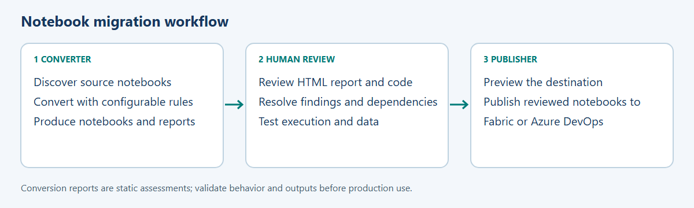

# Azure Databricks to Fabric notebook toolkit

Convert exported Azure Databricks notebooks locally, review the results, and optionally publish the notebooks to Microsoft Fabric or an Azure DevOps repository. The toolkit has two independent components: a **converter** and a **publisher**. Human review and testing are required between them.

| Stage | What happens |
|---|---|
| **Converter** | Recursively discovers supported source exports, applies configurable rules, and writes notebooks and conversion reports to a new timestamped folder. |
| **Human review** | Examine the HTML report and converted code; resolve review and manual findings, dependencies and environment-specific settings. |
| **Publisher** | Preview and optionally publish the reviewed notebooks to a Fabric workspace or a new Azure DevOps branch. |

## Get started

1. Clone or download the repository. Install Python 3.9 or later; the utilities use the Python standard library.
2. Follow the [converter guide](converter/README.md) to prepare exports, configure mappings and run conversion, using either the `.bat` launcher or the command line. Note the output folder printed in the console.
3. Open `_report/report.html`, review the findings and validate the notebook behavior and data in Fabric. See the [converter guide](converter/README.md#outputs-and-report) for how to read it.
4. Follow the [publisher guide](publisher/README.md) to preview and, when ready, publish the reviewed output, again with either the `.bat` launcher or the command line.

The converter works on local or locally synchronized folders and does not require Databricks, ADF or ADLS connectivity. It supports Databricks `.py` and `.sql` source exports; unsupported formats and patterns need separate migration. A report's coverage is a static indicator, not proof of successful execution or equivalent results.

Reports may contain source code. Keep generated output in an approved location and do not commit credentials, private notebooks, environment-specific configuration or generated reports. No license is granted by this repository; confirm distribution and licensing approval before reuse.
