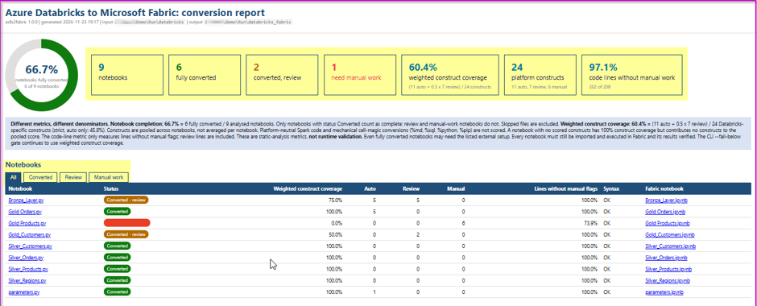
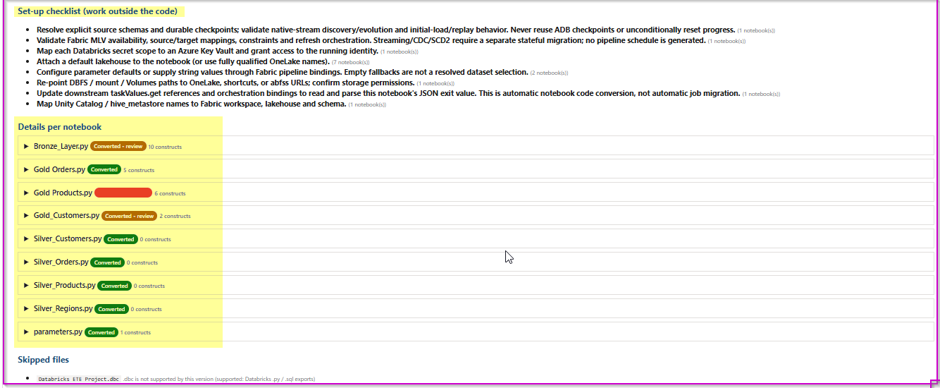
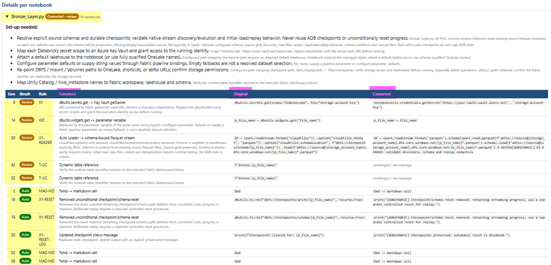

# Databricks to Fabric notebook converter

The converter recursively scans a local folder for Azure Databricks `.py` and `.sql` source exports, applies configurable migration rules, and produces Fabric-importable `.ipynb` notebooks and reports. Supported patterns include selected widgets, secrets, paths, notebook calls, tables, Auto Loader, DLT and MLflow. Unsupported cases are flagged for review or manual work.

## Prerequisites and setup

* Python **3.9 or later**; no Python packages need to be installed.
* Git to clone the repository, or download and extract it as a ZIP.
* Readable Databricks notebook source exports in a local or locally synchronized folder, and a writable output location outside the input tree.
* Windows for the `.bat` launcher and folder picker. Command-line conversion can also run on other systems with Python.

```powershell
git clone "<repository-url>" C:\work\toolkit
cd C:\work\toolkit\converter
python --version
```

Replace the URL and path with your repository and clone location. If the toolkit is in a repository subfolder, enter that subfolder before `converter`. If using a ZIP, extract it and navigate to its `converter` folder. Azure CLI, Spark, ADLS, ADF and a Databricks connection are not required for local conversion.

## Run the converter

**Windows launcher:** Double-click `Convert-ADB-to-Fabric.bat` and select the input folder, or drag the folder onto the launcher. Check the console for errors and the actual output path. The HTML report opens automatically.

**Command line:** From the `converter` folder:

```powershell
python -m adb2fabric "C:\work\databricks-exports" -o "C:\work\converted"
```

Each run scans the selected folder **recursively** and processes all supported notebooks found there. To rerun only a subset, place that subset in a separate input folder. `-o` is a prefix: the example produces `C:\work\converted_YYYYMMDDHHMM`. Without `-o`, the default is a sibling `<input>_fabric_YYYYMMDDHHMM` folder. Same-minute collisions add `_01`, `_02`, and so on. Every run creates a new folder; existing notebooks and reports are not deleted or overwritten. Use the actual path printed in the console.

Add `--dry-run` to create a report without writing notebooks, `--no-open` to prevent opening the report, or `--include-plain` to include `.py` and `.sql` files without a Databricks notebook header. Run `python -m adb2fabric --help` for all options. Reports contain code; store them in an approved location.

## Outputs and report

The output preserves the input folder structure and contains converted notebooks and an `_report` folder:

| File in `_report` | Purpose |
|---|---|
| `report.html` | Dashboard, status, checklist, skipped files and detailed code findings. |
| `report.json` | Machine-readable results and metrics. |
| `items.csv` | Detected constructs, source and converted code, rules and recommended actions. |
| `manual_work.csv` | Findings requiring manual work. |

The report is organized for engineering review:

**Summary and coverage**



**Setup checklist, skipped files and notebook-level details**



**Original code, conversion rule and converted output**



* **Summary and coverage:** The report presents notebook completion, construct coverage, lines without manual flags and the counts of fully converted, review and manual-work notebooks. These checkpoints provide a quick view of migration status across the complete run.
* **Notebook list:** The top-level table lists each notebook with its status, weighted coverage and construct counts. Use the filters to view `Converted`, `Converted - review`, or `Needs manual work` notebooks.
* **Setup checklist and skipped files:** The report explains environment and engineering actions such as storage and schema validation, source or target mappings, library setup and secret or Key Vault configuration. It also identifies unsupported or skipped files.
* **Cell and construct details:** The last section shows the conversion result for each code construct. Engineering teams can use these details to review findings and update migration configuration where appropriate.

Each construct is displayed in one of three result categories:

| Result | Color | Meaning |
|---|---|---|
| **Converted** | Green | The construct was converted automatically and did not record a review or manual finding. |
| **Converted - review** | Brown | A replacement was produced, but the construct requires engineering review or environment configuration. |
| **Needs manual work** | Red | The construct requires a manual code change or migration decision. |

Drill down to a notebook from the notebook table or details section. Each row shows the original code, the matched conversion rule or construct type, and the converted output. Compare the source and generated code, use the rule and message to understand the action, and resolve any review or manual item before execution.

Notebook completion counts fully converted notebooks divided by analyzed notebooks; weighted construct coverage is `(Auto + 0.5 × Review) / scored constructs`. A notebook with no scored constructs can report 100% coverage. These are static indicators, not proof of successful execution or equivalent results.

## Configure migration rules

Edit [conversion-rules.json](adb2fabric/conversion-rules.json) before starting a new converter process. The converter loads this file at process start. Existing mappings for paths, tables, notebook references, parameters and secret scopes are empty by default.

The configuration is organized by feature area. Keep the existing top-level sections and use them to configure environment-specific values:

```json
"table_mappings": {
  "source_catalog.sales.orders": "lakehouse_catalog.sales.orders"
},
"secret_scopes": {
  "adb_secret_scope": "fabric_keyvault_name"
},
"notebook_mappings": {
  "shared/notebooks/load_orders": "shared/notebooks/load_orders_fabric"
},
"parameter_defaults": {
  "environment": "development"
}
```

Use these mappings only after confirming the target names in your Fabric environment. Never add passwords, PATs, SAS strings or secret values to the JSON file.

### Rule structure

The `rules` array contains ordered regex-based migration rules. Each rule can identify a construct and:

* Replace it with a direct text replacement.
* Use a supported Python handler for context-aware conversion.
* Mark it as **AUTO**, **REVIEW** or **MANUAL**.
* Add a setup checklist item or explanatory message.

Required fields are `id`, `title`, `pattern` and `level`. Optional fields include `scope`, `replacement`, `handler`, `message`, `checklist`, `silent` and `flags`.

| Field | Purpose |
|---|---|
| `id` | Unique rule identifier. Keep it stable so reports and rule references remain recognizable. |
| `title` | Short description shown with the rule. |
| `pattern` | Python-compatible regular expression matched in the source code. Escape JSON backslashes as `\\`. |
| `level` | `AUTO` replaces or converts without manual code, `REVIEW` needs engineering review, and `MANUAL` requires implementation by hand. |
| `scope` | Optional source scope: `py`, `sql`, or `any`. The default is `py`. |
| `replacement` | Regex replacement text. Named or numbered capture groups can be referenced with `\\g<name>` or `\\1`. Use `replacement` for direct transformations. |
| `handler` | Calls a supported context-aware handler. Handler rules require the named capture groups declared by that handler. |
| `message` | Explanation or recommended action shown in the report. |
| `checklist` | Optional two-item setup entry such as `["keyvault", "Describe the required Key Vault action"]`. |
| `flags` | Optional regex flags. Supported values include `IGNORECASE`, `MULTILINE` and `DOTALL`. |
| `silent` | Hides the construct from findings but only for rules that also provide a checklist item. |

A rule must use `replacement` or `handler`, not both. `MANUAL` rules cannot perform replacements or call handlers.

### Direct replacement example

This example converts a Databricks filesystem call to the Microsoft Fabric notebook utility:

```json
{
  "id": "F1",
  "title": "dbutils.fs -> notebookutils.fs",
  "pattern": "\\bdbutils\\.fs\\.(ls|cp|mv|rm|mkdirs|head|put|append)\\b",
  "level": "AUTO",
  "replacement": "notebookutils.fs.\\1"
}
```

The capture group `(ls|cp|mv|...)` is returned by `\1`, so `dbutils.fs.ls` becomes `notebookutils.fs.ls`.

### Handler-based rule example

Handler rules preserve more context than a direct replacement. The named groups must match the handler signature:

```json
{
  "id": "W1",
  "title": "dbutils.widgets definition -> parameters cell",
  "pattern": "^(?P<indent>\\s*)dbutils\\.widgets\\.(?:text|dropdown|combobox|multiselect)\\(\\s*(?P<q>[\"'])(?P<name>\\w+)(?P=q)\\s*,\\s*(?P<q2>[\"'])(?P<default>[^\"']*)(?P=q2).*\\)\\s*$",
  "level": "REVIEW",
  "handler": "widget_define",
  "message": "Fabric has no widgets. The default became a variable in a parameters cell; values passed by a pipeline arrive as strings and dropdown choices are lost."
}
```

Supported handler names and required named groups are validated when the configuration loads. Do not add arbitrary Python or shell commands to JSON rules. Implement complex context-sensitive transformations in the converter package rather than a rule entry.

### Adding or updating rules

1. Back up `conversion-rules.json`.
2. Give the new rule a unique `id` and choose an appropriate `level`, `scope` and reporting fields.
3. Preserve the final `Z9` manual catch-all rule as the last entry in the `rules` array.
4. Start a converter process and run `python -m adb2fabric --dry-run` against a representative set of notebooks.
5. Review `report.html`, `items.csv` and the generated code. Incorrect broad patterns can change unrelated code.

Invalid JSON, duplicate rule IDs, unsupported handler names, missing named groups and malformed regex patterns produce a configuration error. Restart the converter after editing the file because it is loaded at process start.

## Assumptions and troubleshooting

* `.dbc`, `.ipynb`, `.scala` and `.r` file exports are not supported. The report lists skipped files and conversion errors. Use `--include-plain` only when ordinary source files should also be processed.
* Auto Loader defaults to an explicit schema and retains checkpoint resets. Optional inference or reset removal can change schema or replay behavior; validate before use.
* The converter does not move data, provision resources, install libraries or migrate job orchestration. Configure lakehouses, secrets, permissions and dependencies separately.
* If no notebooks are found, check the selected folder, export format and Databricks source header. If output creation fails, use a writable prefix outside the input tree.
* Review and test notebooks in a suitable Fabric workspace. See the [publisher guide](../publisher/README.md) for the separate publishing step.
