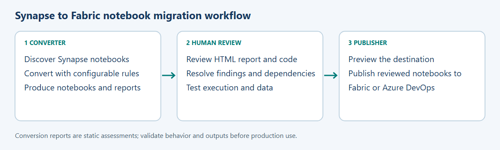

# Azure Synapse to Fabric notebook toolkit

Convert exported Azure Synapse Spark notebooks locally, review the results, and optionally publish the notebooks to Microsoft Fabric or an Azure DevOps repository. The toolkit has two independent components: a **converter** and a **publisher**. Human review and testing are required between them.

| Stage | What happens |
|---|---|
| **Converter** | Recursively discovers Synapse notebooks, applies configurable rules, and writes Fabric notebooks and conversion reports to a new timestamped folder. |
| **Human review** | Examine the HTML report and converted code; resolve review and manual findings, dependencies and environment-specific settings. |
| **Publisher** | Preview and optionally publish the reviewed notebooks to a Fabric workspace or a new Azure DevOps branch. |

## Get started

1. Clone or download the repository. Install Python 3.9 or later; the utilities use the Python standard library.
2. Follow the [converter guide](converter/README.md) to export notebooks, configure mappings and run conversion. Note the output folder printed in the console.
3. Open `_report/report.html`, review the findings and validate the notebook behavior and data in Fabric.
4. Follow the [publisher guide](publisher/README.md) to preview and, when ready, publish the reviewed output.

The converter works on local or locally synchronized folders and does not require a connection to Synapse. It reads Synapse Studio `.ipynb` exports and Synapse workspace or Git notebook `.json` files; other artifacts such as pipelines, Spark job definitions and linked services are skipped and listed in the report. A report's coverage is a static indicator, not proof of successful execution or equivalent results.

For migrations that include pools, libraries, lake databases and Spark job definitions, also consider the [Spark Migration Assistant](https://learn.microsoft.com/fabric/data-engineering/synapse-to-fabric-spark-migration-assistant) and Microsoft's [Synapse Spark migration guidance](https://learn.microsoft.com/fabric/data-engineering/migrate-synapse-overview). This toolkit refactors notebook code and does not migrate data, metadata or infrastructure.

Reports may contain source code. Keep generated output in an approved location and do not commit credentials, private notebooks, environment-specific configuration or generated reports. No license is granted by this repository; confirm distribution and licensing approval before reuse.
