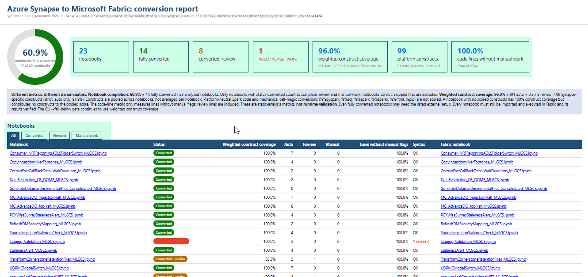
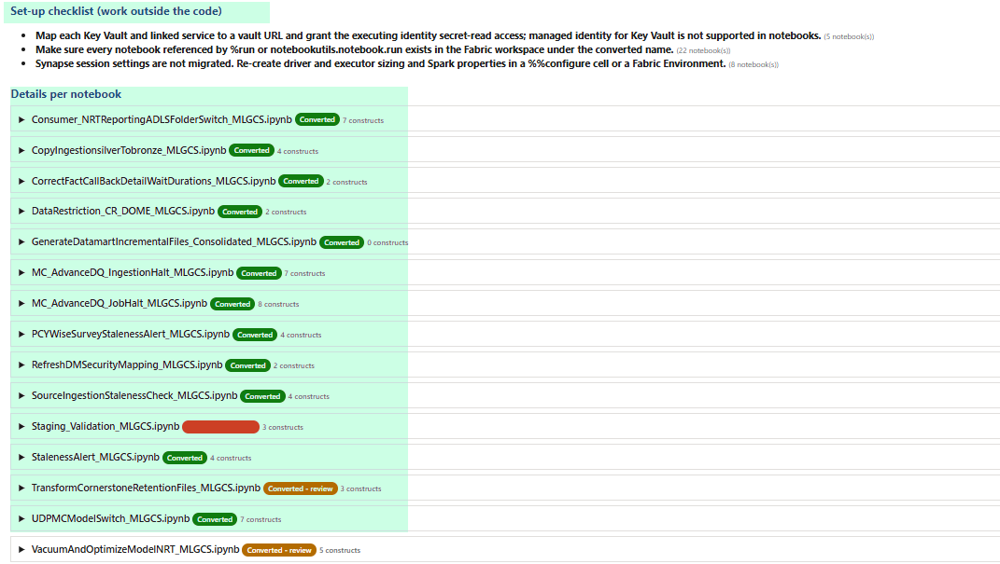
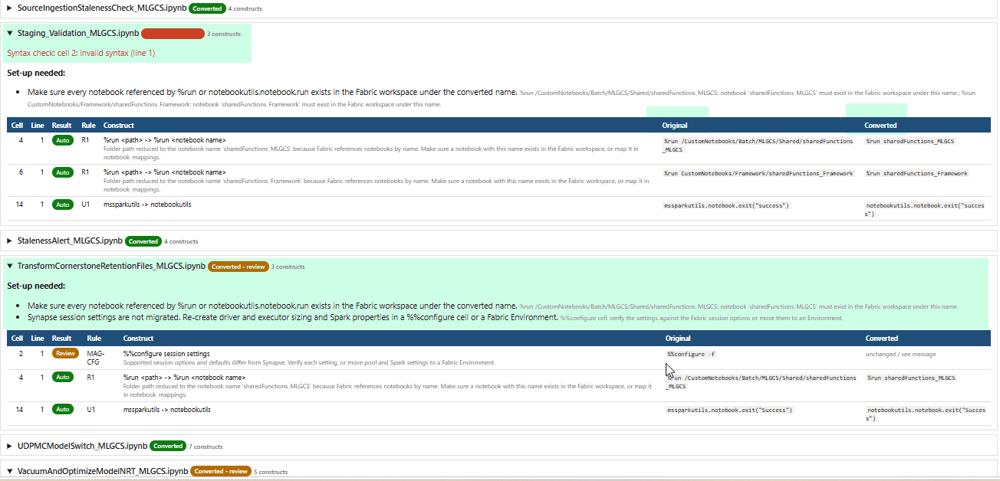

# Synapse to Fabric notebook converter

The converter recursively scans a local folder for Azure Synapse Spark notebooks, applies configurable migration rules, and produces Fabric-importable `.ipynb` notebooks and reports. It refactors the Synapse-specific patterns that Microsoft documents for Fabric migration: `mssparkutils` to `notebookutils`, Key Vault and linked-service secrets, `spark.catalog` APIs, Synapse-managed and external storage paths, `%run` references, session settings and unsupported cells. Unsupported cases are flagged for review or manual work.

## Prerequisites and setup

* Python **3.9 or later**; no Python packages need to be installed.
* Git to clone the repository, or download and extract it as a ZIP.
* Synapse notebooks exported to a local folder: Synapse Studio **Export > Notebook (.ipynb)**, or the notebook `.json` files from a workspace or Git repository. The converter does not connect to Synapse.
* A writable output location outside the input tree.
* Windows for the `.bat` launcher and folder picker. Command-line conversion can also run on other systems with Python.

```powershell
git clone "<repository-url>" C:\work\toolkit
cd C:\work\toolkit\converter
python --version
```

Replace the URL and path with your repository and clone location. If the toolkit is in a repository subfolder, enter that subfolder before `converter`.

## Run the converter

**Windows launcher:** Double-click `Convert-Synapse-to-Fabric.bat` and select the input folder, or drag the folder onto the launcher. Check the console for errors and the actual output path. The HTML report opens automatically.

**Command line:** From the `converter` folder:

```powershell
python -m syn2fabric "C:\work\synapse-exports" -o "C:\work\converted"
```

Each run scans the selected folder **recursively** and processes every Synapse notebook found there. To convert only a subset, place that subset in a separate input folder. `-o` is a prefix: the example produces `C:\work\converted_YYYYMMDDHHMM`. Without `-o`, the default is a sibling `<input>_fabric_YYYYMMDDHHMM` folder. Same-minute collisions add `_01`, `_02`, and so on. Every run creates a new folder; existing notebooks and reports are never deleted or overwritten. Use the actual path printed in the console. The output folder must not be inside the input folder.

Options: `--dry-run` creates a report without writing notebooks, `--config <file>` uses a different rules file, `--include-plain` also converts generic `.ipynb` files that lack Synapse metadata, `--no-open` prevents opening the report, and `--fail-below <pct>` returns exit code 3 below that weighted coverage. Run `python -m syn2fabric --help` for details. Reports contain code; store them in an approved location.

## Outputs and report

The output preserves the input folder structure and contains converted notebooks and an `_report` folder:

| File in `_report` | Purpose |
|---|---|
| `report.html` | Dashboard, status, setup checklist, skipped files and code-level findings. |
| `report.json` | Machine-readable results and metrics. |
| `items.csv` | Detected constructs, source and converted code, rules and recommended actions. |
| `manual_work.csv` | Findings requiring manual work. |

The report is organized for engineering review:

**Summary and coverage**



**Setup checklist and notebook-level details**



**Original code, conversion rule and converted output**



* **Summary and coverage:** notebook completion, weighted construct coverage, lines without manual flags and the counts of converted, review and manual-work notebooks.
* **Notebook list:** each notebook with its status and construct counts, filterable by result.
* **Setup checklist and skipped files:** work outside the code, such as Key Vault access, linked-service replacement, storage and lakehouse setup, pool and Environment decisions; plus files that were skipped and why.
* **Cell and construct details:** for each notebook, the cell and line, the matched rule, the original code and the converted output.

| Result | Color | Meaning |
|---|---|---|
| **Converted** | Green | Converted automatically with no review or manual finding. |
| **Converted - review** | Brown | A replacement was produced, but it needs engineering review or environment configuration. |
| **Needs manual work** | Red | A manual code change or migration decision is required. |

Converted notebooks carry `REVIEW[SYN2FABRIC]` and `TODO[SYN2FABRIC]` comments at the affected lines. Notebook completion counts fully converted notebooks divided by analyzed notebooks; weighted construct coverage is `(Auto + 0.5 × Review) / scored constructs`. Cell-magic conversions that carry no risk are not scored. These are static indicators, not proof of successful execution or equivalent results.

## What is converted

| Synapse | Fabric | Result |
|---|---|---|
| `mssparkutils.*`, `from notebookutils import mssparkutils` | `notebookutils` | Auto |
| `mssparkutils.fs.*`, `notebook.run`, `notebook.exit` | `notebookutils.fs`, `notebookutils.notebook` | Auto / Review |
| `credentials.getSecret(vault, secret)` | `getSecret("https://<vault>.vault.azure.net/", secret)` | Auto |
| `getSecretWithLS(linked service, secret)` | `getSecret(<vault URL>, secret)`; set `linked_services` to fill in the URL | Auto |
| `mssparkutils.env.*` | `notebookutils.runtime.context` | Review |
| `spark.catalog.currentDatabase / listDatabases / getDatabase / registerFunction` | Spark SQL or `spark.udf.register` | Auto / Review |
| `%run <path>` | `%run <notebook name>` | Auto (the notebook must exist in Fabric; `notebook_mappings` can rename it) |
| `abfss://`, `wasbs://` storage, `synfs:` paths | Flagged; mapped with `path_mappings` | Review / Auto |
| `%%configure`, session settings, pool | Checklist for a `%%configure` cell or Fabric Environment | Review |
| `TokenLibrary`, linked-service Spark configuration, `synapsesql`, `/user/trusted-service-user/`, `%%csharp`, unsupported catalog APIs | No automatic equivalent | Manual |

Cell kinds `%%pyspark`, `%%sql`, `%%spark`, `%%sparkr` and `%%html` are retained. Cell outputs are not carried over.

## Configure migration rules

Edit [conversion-rules.json](syn2fabric/conversion-rules.json), or copy it and pass the copy with `--config`. The file is loaded when the converter starts. Environment-specific mappings are empty by default:

```json
"key_vaults": {
  "kv-prod": "https://contoso-prod.vault.azure.net/"
},
"linked_services": {
  "kvLinkedService": "https://contoso-prod.vault.azure.net/"
},
"notebook_mappings": {
  "/CustomNotebooks/Batch/Shared/sharedFunctions": "sharedFunctions_Fabric",
  "Common_Utils": "Common Utilities"
},
"table_mappings": {
  "salesdb.orders": "lakehouse.sales.orders"
},
"path_mappings": [
  {
    "id": "raw",
    "source": "abfss://raw@account.dfs.core.windows.net/",
    "target": "abfss://<workspace-id>@onelake.dfs.fabric.microsoft.com/<lakehouse-id>/Files/raw/"
  }
]
```

Use these mappings only after confirming the target names in Fabric. `notebook_mappings` keys can be the full `%run` path or just the notebook name. Without a mapping, `%run /folder/Name` is converted to `%run Name`; the notebook must exist in the Fabric workspace under that name. Never add passwords, PATs, SAS strings or secret values to the file.

### Rule structure

The `rules` array contains ordered regex-based rules. Required fields are `id`, `title`, `pattern` and `level` (`AUTO`, `REVIEW` or `MANUAL`). Optional fields are `scope` (`py`, `sql` or `any`; default `py`), `replacement`, `handler`, `message`, `checklist`, `silent`, `skip_on_manual` and `flags`. A rule uses `replacement` or `handler`, not both, and `MANUAL` rules cannot replace code. Escape JSON backslashes as `\\`.

Direct replacement:

```json
{
  "id": "F1",
  "title": "mssparkutils.fs -> notebookutils.fs",
  "pattern": "\\bmssparkutils\\.fs\\.(ls|cp|fastcp|mv|rm|mkdirs|head|put|append|exists)\\b",
  "level": "AUTO",
  "scope": "any",
  "replacement": "notebookutils.fs.\\1"
}
```

Handler-based rules use a supported handler for context-aware conversion; the pattern must define the named groups the handler needs:

```json
{
  "id": "R1",
  "title": "%run <path> -> %run <notebook name>",
  "pattern": "^(?P<indent>\\s*)%run\\s+(?P<flags>(?:-\\S+\\s+)*)(?P<target>\"[^\"]+\"|'[^']+'|[^\\s{]+)(?P<rest>.*)$",
  "level": "AUTO",
  "handler": "run_notebook"
}
```

Supported handlers are `key_vault_secret`, `key_vault_secret_ls`, `run_notebook` and `env_context`. More complex transformations belong in the converter package, not in JSON. To add a rule: back up the file, give it a unique `id`, run `python -m syn2fabric <folder> --dry-run`, and review `report.html` and `items.csv`; an over-broad pattern can change unrelated code. Invalid JSON, duplicate IDs, unknown handlers, missing named groups and malformed regexes stop the run with a configuration error.

## Assumptions and troubleshooting

* Pipelines, Spark job definitions, linked services, datasets, SQL scripts and other artifacts are skipped and listed in the report. Spark pools, libraries and lake database metadata are not migrated; use the Spark Migration Assistant and Fabric Environments for those.
* `.NET for Spark` (`%%csharp`), dedicated SQL pool connector calls, `TokenLibrary` and linked-service authentication have no Fabric equivalent and are flagged as manual work.
* Managed identity for Key Vault is not supported in Fabric notebooks. The identity running the notebook needs secret-read access to each vault.
* If no notebooks are found, check the folder, the export format and that the notebooks are Synapse notebooks (use `--include-plain` for generic notebooks). If output creation fails, use a writable prefix outside the input tree.
* Review and test notebooks in a suitable Fabric workspace and runtime before promotion. See the [publisher guide](../publisher/README.md) for the separate publishing step.
